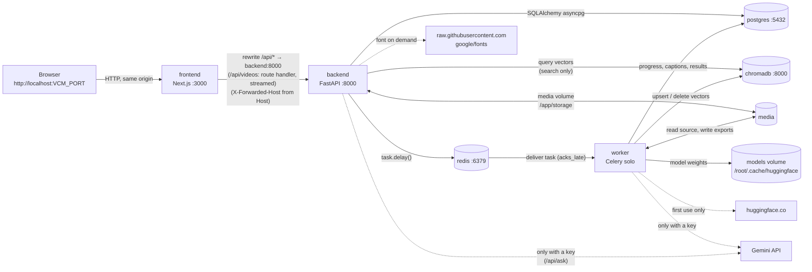
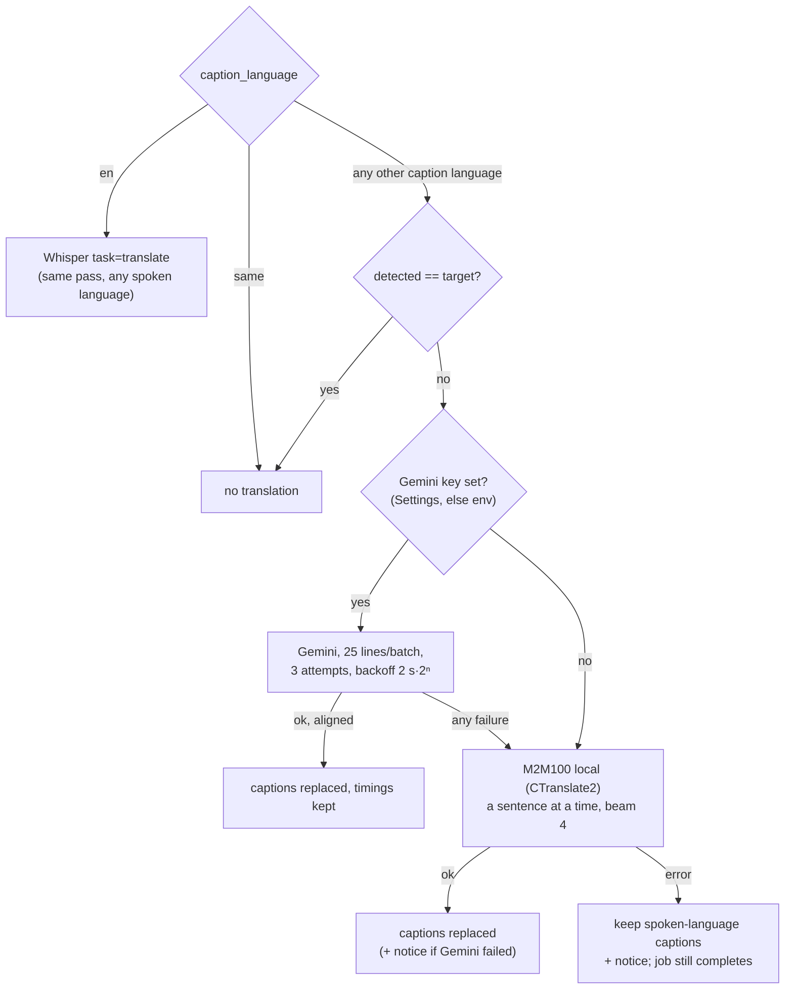

# Architecture

How VideoCaptionMaker is built, as of v1.0.6 (released 2026-10-15). Every statement points at the
file it comes from. Auth and the request guard are in
[SECURITY.md](SECURITY.md); tables are in [DATABASE.md](DATABASE.md); endpoints
are in [API.md](API.md).

## 1. System overview

Six containers under Docker Compose: a Next.js UI, a FastAPI API, a Celery
worker, Postgres, Redis and ChromaDB. The API and the worker are **one image**
started with different commands (`api` / `worker` in
`backend/docker-entrypoint.sh`). Only the UI port is published, on
`127.0.0.1:${VCM_PORT:-3000}` (`docker-compose.prod.yml`). The browser never
talks to the API directly: Next rewrites `/api/*` to `http://backend:8000`
(`frontend/next.config.js`), except `/api/videos`, which a route handler
forwards (`frontend/src/app/api/videos/route.ts`, v1.2.0). Next's rewrite
proxy copies each request body and keeps the copy: Next 14 held every upload
whole in memory (34 → 241 MiB for a 192 MB upload) and Next 15 keeps only
the first 10 MB, which cut larger uploads off. The route handler streams the
upload to the API with Node's `http`, with backpressure, in constant memory
(a 2 GB upload peaked at 79 MiB), giving up only on a connection quiet for
30 minutes; `forwarded-for.js` turns off Node's 5-minute limit on receiving a
request, so a slow upload isn't cut off. A cancelled upload ends the API's
request, and the API's partial file goes with it.

| Service | Image (prod) | Role |
|---|---|---|
| `frontend` | `ghcr.io/tanush1206/video-caption-maker-frontend:<ver>` (Node 20 Alpine, Next standalone) | UI and same-origin `/api` proxy |
| `backend` | `…-backend:<ver>-<cpu\|cuda>`, command `api` | runs `alembic upgrade head`, then uvicorn on :8000 |
| `worker` | same image, command `worker` | Celery, `--pool=solo`: transcription, translation, embedding, rendering |
| `postgres` | `postgres:16.14-alpine` | relational data |
| `redis` | `redis:7.4.10-alpine`, no persistence | Celery broker and result backend; rate-limit buckets and denylist (accounts mode) |
| `chromadb` | `chromadb/chroma:1.0.0` | caption embeddings for semantic search |

## 2. How the services communicate



**Rules that follow from this:**

- The browser **must** only call relative `/api/...` paths. `API_URL` is
  empty in production builds (`frontend/src/lib/config.ts`); the dev compose
  sets it to `http://localhost:8000`.
- The API **never** runs a long job in a request. It writes a row, calls
  `.delay()`, and returns. The worker writes progress into the row in its own
  short session (`_set_progress` in `backend/app/workers/transcription.py`),
  and the UI polls:
  - the video list every 2 s while anything is `pending`/`processing`
    (`frontend/src/hooks/use-videos.ts`);
  - exports every 1.5 s while one is rendering (`use-exports.ts`);
  - transcription alerts every 3 s (`use-transcription-alerts.ts`).

  Polling stays: progress changes a few times a minute ([DECISIONS.md](DECISIONS.md) D10).
- **Forwarded headers are believed only from the frontend.** uvicorn runs with
  `--no-proxy-headers` (`backend/docker-entrypoint.sh`). The
  `TrustedProxyHeaders` middleware (`backend/app/proxy_headers.py`, the
  outermost layer in `main.py`) applies `X-Forwarded-For`/`-Proto` only when
  the peer is an address that `TRUSTED_PROXIES` (default `frontend`)
  resolves to. It re-resolves at most every 5 s, because a recreated frontend
  container gets a new IP and Docker can hand the old one to another
  container. The frontend overwrites both headers with its own socket's peer
  before proxying (`frontend/forwarded-for.js`, preloaded with `node -r`), so
  `audit.log`'s client can't be forged. For a browser on the host, that peer
  is Docker's gateway ([SECURITY.md](SECURITY.md) §4a).

  Polling was chosen over SSE or websockets (see [DECISIONS.md](DECISIONS.md)).
- Only the worker sees the GPU. At `worker_ready` it writes a hardware report
  to `app_settings.worker_hardware`; the API reads that rather than probing its
  own GPU-less container (`backend/app/workers/celery_app.py`,
  `backend/app/api/system.py`).

### Shared volumes (prod)

| Volume | Mounted at | In | Holds |
|---|---|---|---|
| `db` | `/var/lib/postgresql/data` | postgres | database |
| `vectors` | `/data` | chromadb | vector store |
| `media` | `/app/storage` | backend, worker | uploads, thumbnails, waveforms, exports, `audit.log` |
| `models` | `/root/.cache/huggingface` | backend, worker | Whisper, M2M100, MiniLM weights |
| `fonts` | `/usr/share/fonts/truetype/vcm-cache` | backend, worker | Google Fonts fetched on demand |
| `./certs` (bind, ro) | `/usr/local/share/ca-certificates/extra` | backend, worker | optional extra root CAs |

## 3. Project structure

```
.
├── backend/
│   ├── app/
│   │   ├── main.py              FastAPI app: CORS, request guard middleware, router
│   │   ├── config.py            every env setting, typed (pydantic-settings)
│   │   ├── database.py          async engine + Base + get_db
│   │   ├── dependencies.py      CurrentUser / DbSession (local mode → the one user)
│   │   ├── request_guard.py     local-mode host/origin guard + audit.log
│   │   ├── proxy_headers.py     X-Forwarded-* believed only from the frontend
│   │   ├── api/                 routers, one per resource; thin, call services
│   │   ├── schemas/             Pydantic request/response models
│   │   ├── models/              SQLAlchemy ORM models (one table per file)
│   │   ├── services/            all logic: hardware, transcription, translation,
│   │   │                        embeddings, search, rag, rendering, storage…
│   │   ├── workers/             Celery app and tasks; recovery at startup
│   │   ├── utils/               JWT/bcrypt, rate limit, filenames, denylist
│   │   └── data/google_fonts.json   generated font catalogue
│   ├── alembic/versions/        13 migrations (see DATABASE.md)
│   ├── tests/                   pytest suite (runs against the dev stack)
│   ├── scripts/build_font_catalogue.py
│   ├── Dockerfile               targets: deps → runtime → dev; VARIANT=cpu|cuda
│   ├── Dockerfile.dockerignore  allow-list for the root build context
│   ├── docker-entrypoint.sh     api | worker | exec
│   ├── pyproject.toml, constraints.txt, pytest.ini, alembic.ini, ruff.toml
├── frontend/
│   ├── src/app/                 App Router: (dashboard)/{dashboard,editor/[id],search,search/[id],settings},
│   │                            (auth)/{login,register} (accounts mode only), healthz/
│   ├── src/components/          ui/ primitives, layout/, videos/, captions/, styles/,
│   │                            exports/, search/, settings/, flow/, player/, dashboard/
│   ├── src/hooks/               TanStack Query hooks, one per resource
│   ├── src/lib/                 api client, config, utils (cn), stages, format…
│   ├── src/stores/auth.ts       Zustand: in-memory access token + user
│   ├── src/types/               TS types mirroring the API schemas
│   ├── src/middleware.ts        local mode: / /login /register → /dashboard
│   ├── public/fonts/            caption fonts (also copied into the backend image)
│   ├── tailwind.config.ts, next.config.js, Dockerfile
├── install/                     install.sh, install.ps1, vcm, vcm.ps1, vcm.cmd
├── scripts/                     e2e.py, update_layers.py, ui-check/ (Playwright + axe)
├── docker-compose.yml           dev stack (bind mounts, hot reload)
├── docker-compose.prod.yml      installed app (project `vcm`)
├── docker-compose.gpu.yml       NVIDIA override for either
└── .github/workflows/           ci.yml, release.yml
```

## 4. The job pipeline

### 4.1 Transcription (`transcribe_video`, `backend/app/workers/transcription.py`)

```mermaid
sequenceDiagram
    participant UI as Browser
    participant API as backend
    participant Q as redis
    participant W as worker
    participant DB as postgres
    participant V as chromadb
    UI->>API: POST /api/videos (file, hold=true) as soon as a file is picked
    API->>API: stream to /app/storage/user_N/<uuid>.<ext>, ffprobe duration, thumbnail
    API->>DB: INSERT videos (status=pending, held, stage=detecting)
    API->>Q: detect_spoken_language.delay(id)
    API-->>UI: 201 VideoRead
    Q->>W: detect: first 30 s → videos.detected_language, detected_confidence
    loop every 1 s until heard (15 s, then the step asks without a preset)
      UI->>API: GET /api/videos/{id}
    end
    UI->>API: POST /api/videos/{id}/transcribe (spoken, caption, hindi_script) = Start
    API->>DB: held=false, status=pending
    API->>Q: transcribe_video.delay(id)
    Q->>W: deliver (prefetch 1, acks_late)
    W->>DB: read languages, Settings (whisper_model, gemini key)
    W->>DB: DELETE captions; W->>V: delete vectors (idempotent re-run)
    W->>W: 0 downloading: load Whisper (unloads translator)
    W->>W: 1 extracting: FFmpeg → <src>.transcode.wav
    W->>W: 2 transcribing: detect language (30 s) if auto; Hindi in Roman → load the Hinglish model; decode, then re-decode skipped stretches
    W->>W: 2b translating: Hinglish → IndicXlit Devanagari first; Gemini → fallback M2M100 (unloads Whisper)
    W->>W: 3 phrases: rephrase and time to the word timestamps
    W->>DB: INSERT captions, videos.speech
    W->>V: 4 embedding: upsert "{video}:{caption}" vectors
    W->>DB: status=completed, notice
    loop every 2 s while busy
      UI->>API: GET /api/videos
    end
```

Stage names are fixed strings, written to `videos.stage`: `detecting` (a
held upload, v1.0.9), `downloading`, `extracting`, `transcribing`,
`translating`, `embedding`. The UI labels for
them are in `frontend/src/lib/stages.ts`.

Rules the code enforces:

- **Idempotent.** A run deletes the video's captions and vectors before
  writing new ones. That is what makes `task_acks_late=True` and requeueing
  safe.
- **The WAV is always deleted** (`finally`).
- **Indexing failure is not job failure.** Captions are kept and search
  degrades.
- **Translation failure is not job failure.** Captions stay in the spoken
  language, with a notice.
- **Any other exception** marks the video `failed` with a sentence from
  `friendly_error` (truncated to 500 chars), then re-raises so Celery records
  it.
- **Settings are read per job, not per process**, so a model change in
  Settings applies to the next job.
- **Held uploads** (v1.0.9) are the language step's: uploaded on pick with
  `hold`, listened to by `detect_spoken_language` (the job's own model and
  window), and started by `POST …/transcribe`. They are left out of the
  list, the stats and startup recovery; the page deletes one on Back or
  close (a `keepalive` DELETE), and `sweep_held` deletes any never started
  after an hour, on the user's next upload. A failed detection clears the
  stage, and the step then asks without a preset.
- **How Hindi is written** (v1.0.9, `languages.hindi_script_for`): a choice
  of `roman` or `devanagari` is kept; `auto` presets Roman for Hindi heard
  at 70% or more and otherwise Devanagari, and the result is stored; NULL
  (older videos, clients that don't send it) is Devanagari. Roman, unless
  the captions are English, loads the Hinglish speech model
  (`services/hinglish.py`, Oriserve's Apex fine-tune of large-v3-turbo),
  decodes under Whisper's English token as its card says, and records the
  captions as Hindi. A translation of Hinglish into anything but English is
  made from Devanagari: IndicXlit transliterates word by word (all-capital
  words like SRT kept), then Gemini or M2M100 translates as from Hindi.
  English captions are always Whisper's own `translate` pass, which read far
  better than M2M100 from either script (PROGRESS.md, v1.0.9). The job also
  stores what it heard, so the editor's Redo offers the script choice.
- **Nothing Whisper heard is skipped** (v1.0.8). Each window is decoded
  without the previous one's text (`condition_on_previous_text=False`), no
  word's timing is believed past 3 s (`WORD_MAX_SECONDS`: alignment hands
  the last word before a pause the whole pause), and every stretch of 4 s or
  more with no caption is cut out and decoded again on its own, repeatedly
  inside what that finds, three levels deep (`_fill_skipped`). Invented text
  over silence is dropped by the same silence check as the rest.
- **Silence that would swallow the speech is re-measured** (v1.0.11,
  `silence_for`): FFmpeg's `silencedetect` under -40 dB as before, unless
  more than half of the file's voiced envelope windows (speech band within
  18 dB of its speaking level) fall inside that silence; then 15 dB under
  the speaking level, never under -80 dB (`silence_threshold`). On FLEURS
  every clip that came back empty had all its speech inside -40 dB silence
  (a quiet recording, speech at -56 to -64 dB); every clip that worked, at
  most 35%. Lowering it for every moderately quiet file instead let faint
  noise around clear speech stop being silence, and invented text over it
  ("Vielen Dank.") survive. A job that ends with no
  captions completes with the notice "No speech was found in this video."
  (`NO_SPEECH_NOTICE`).
  Since v1.0.10, on every model:
  - a shorter stretch is decoded again too when more than 0.7 s of it is
    speech (the speech band within 18 dB of the clip's speaking level);
  - stretches are measured between the words, not the segments' bounds (a
    snapped start isn't a gap);
  - what a stretch decoded alone finds may start up to 0.5 s before it (the
    onset snap nudges starts back by up to 0.25 s);
  - a word it repeats from either neighbour is said once (one word in four
    may be spelled differently, "set"/"सेट"), the copy timed late dropped;
  - speech that still decodes to nothing is left empty and logged, never
    invented.
- **Captions are phrases timed to the speech** (v1.0.8,
  `services/phrasing.py`), the last step before saving, in every language:
  - each segment carries its words' timings (`Segment.speech`), kept through
    translation; the video keeps them too (`videos.speech`);
  - captions are joined into sentences (punctuation, or a pause over 1 s),
    split into runs of speech at every pause of 0.5 s or more, and each run
    into phrases of about 32 characters (punctuation, then natural word
    groups: never starting with an auxiliary or postposition, preferably
    starting at a conjunction; no lone words);
  - every word gets its own time (v1.0.9): matched to Whisper's timed words
    in order (a sequence match, so a word Whisper left out loses nothing
    else), and an unmatched word is placed between its timed neighbours,
    never anywhere else in the run; untranslated phrases start on their
    first word and end on their last; a sentence that is mostly a
    translation is spread over its runs by speaking time;
  - the words are timed as Whisper timed them, not clipped to the segment's
    onset-snapped start, and kept at zero length (v1.0.9);
  - each word's start is checked on a 20 ms speech-band envelope
    (`_words_on_onsets`): a word that starts in, or just before, a quiet
    stretch of 200 ms or more starts where the voice comes back; a stop
    consonant's closure or a sibilant (both quiet in that band for up to
    ~150 ms) is not a pause;
  - then: a breath under 0.5 s closes to 2 frames (80 ms), a pause stays at
    least 0.5 s, a caption ends at most 0.5 s after its last word and lasts
    0.8-7 s (a squeezed one joins the neighbour the speech runs into);
  - the words are checked unchanged and in order.
  Only this job applies the rules: a caption retimed in the editor keeps its
  times until a Redo. `scripts/caption_quality.py` and
  `backend/scripts/timing_check.py` check a real video against them.

### 4.2 Caption edits → `reindex_captions`

Text edits, adds, splits, merges and deletes queue `reindex_captions(video_id)`
(`backend/app/api/captions.py`, `videos.py`). It re-embeds **the whole
video**: it deletes the vectors, then upserts all current captions. Failure is
logged and never surfaced to the user.

### 4.3 Export (`render_export`, `backend/app/workers/export.py`)

- SRT, VTT and JSON are written **inside the request**
  (`export_service.write_sidecar`) and return `completed`.
- MP4 creates an `exports` row (`pending`) and queues `render_export`:
  1. build an ASS file from the captions and style (`services/subtitles.py`);
  2. run FFmpeg with `scale` **before** `ass` (`_filter_chain`), so glyphs
     are drawn at the output size. `ass`, not `subtitles`: the same libass,
     but the only one of the two that accepts `shaping=complex`, without
     which Indic scripts were drawn unshaped (v1.0.7);
  3. encode with `h264_nvenc` (`-cq 19 -preset p6`) when it works, otherwise
     `libx264 -crf 18 -preset medium` (`services/rendering.py`);
  4. write the progress from FFmpeg's `out_time_us`.
- The output goes to `user_N/exports/<uuid>.<fmt>`. A retry writes a new
  file, never resuming a partial one.
- **Preview = burn.** `lib/caption-style.ts` is the browser twin of
  `to_ass_style`, and three rules keep them at the same size and shape
  (v1.0.7, measured within ~1.5% on burned frames):
  - libass makes a face's whole win cell (usWinAscent + usWinDescent) the
    font size; CSS makes the em the font size. The style serves the face's
    ratio (`font_win_span`); the preview divides by it and uses it as the
    line height;
  - **one layout rule** (`services/caption_layout.py`, mirrored line for
    line in `lib/caption-layout.ts`) decides each caption's lines, size and
    position: the box's width (`box_width`, or 80%/85% by the frame's shape),
    manual line breaks (a newline in the caption starts a line), the line
    style inside each manual line (`balanced`, evened out; `auto`, each line
    filled; `stacked`, `words_per_line` words a line, v1.0.8), the Max lines
    shrink (2% steps to 70%, then one extra line), the fit rule (a box taller
    or wider than the safe area keeps shrinking, to 10%), the position (the
    block, as wide as its longest line, anchored at `pos_x` by its left edge,
    centre or right edge as the alignment says, and centred on `pos_y`;
    v1.2.0) and the slide into the 3% safe area. An alignment change in the
    editor saves the anchor that keeps the caption on screen in place
    (`anchorOf`). SRT and VTT are
    written with the same lines (`subtitles.laid_out_texts`, on the video's
    own frame, in the original letter case). Widths come from HarfBuzz (`uharfbuzz`) on the files libass
    draws with, and from canvas `measureText` in the browser. The ASS gets
    the result per event, `{\an5\pos(x,y)\fs<size>}line\Nline`, under
    WrapStyle 2 with zero margins, so libass neither wraps nor places on its
    own. `scripts/ui-check` `layout-parity` compares the two copies through
    `backend/scripts/caption_layout.py`;
  - Devanagari, Bengali, Tamil and Malayalam are drawn in vendored Noto
    faces (Bengali, Tamil and Malayalam kept after v1.0.11 for the captions
    made in them and for "Try anyway") (`SCRIPT_FONTS`, `frontend/public/fonts`): the ASS names the face
    per run with `\fs` scaled to the caption font's em; CSS lists the faces
    first, each limited to its script with `unicode-range`. Cyrillic gets
    the same treatment (Noto Sans) only when the caption font's own charset
    (`fc-query`) lacks it; the style serves the resulting `script_font_stack`.
- A box (`box_opacity > 0`) is not libass's BorderStyle 3, which boxes
  each font run separately (overlapping translucent boxes where a caption
  mixes script fonts). It is a drawn rectangle (`\p1`) of the layout's exact
  size, on layer 0 under the text, filled with the box colour and opacity;
  the text is BorderStyle 1 with no outline or shadow.
- Render timeout: 3 h (`RENDER_TIMEOUT_SECONDS`), enforced by the FFmpeg
  subprocess itself.
- **No Celery time limits** (`task_soft_time_limit`/`task_time_limit` are
  `None` in `celery_app.py`). Until v1.0.5 they were 30/35 min, which would
  have killed long CPU transcriptions and multi-hour renders, except that
  `--pool=solo` never enforces Celery limits. (Measured: a 6 s task under a
  3 s hard limit ran to completion.) A job is bounded by the timeouts of the
  steps that can hang, listed in §8. `tests/test_worker_config.py` pins this.

## 5. Hardware detection and model choice

`backend/app/services/hardware.py`, run in the worker:

1. `detect()` (cached per process):
   - `cuda` = `ctranslate2.get_cuda_device_count() > 0`;
   - GPU name and VRAM from `nvidia-smi`;
   - RAM = **min(MemTotal, cgroup limit)** (`/sys/fs/cgroup/memory.max` or
     the v1 equivalent);
   - CPU count.
2. `whisper_profile(hw, user_model)`:
   - **Model precedence:** the Settings choice (`app_settings.whisper_model`),
     then `WHISPER_MODEL_SIZE`, then the tier.
   - **Tier:**
     - CUDA with VRAM ≥ 6 GB, or unknown: `large-v3`.
     - CUDA with less VRAM: `small`.
     - CPU with RAM ≥ 12 GB: `large-v3-turbo`.
     - Otherwise: `small`.
   - **Device:** `WHISPER_DEVICE`, unless it asks for `cuda` without CUDA.
   - **Compute:**
     - CUDA: `float16` for large (and `medium`, if set by `WHISPER_MODEL_SIZE`), `int8_float16` otherwise.
     - CPU: `int8`. A `float16` setting on a CPU is overridden, because
       CTranslate2 has no CPU float16 kernel.
3. `translator_profile(hw)`:
   - Model: `TRANSLATION_MODEL`, or `auto`, which means `m2m100_1.2B` with
     RAM ≥ 12 GB and `m2m100_418M` otherwise.
   - Device: on CUDA, the GPU (`int8_float16`); otherwise the CPU (`int8`).
4. **Load fallback.** If Whisper or M2M100 fails to load on CUDA (a driver too
   old, unsupported card, VRAM in use), the worker retries on the CPU with
   `int8`. Whisper's fallback adds a notice to the job.
5. **Memory rule.** `transcription.load_model` calls `translation.unload()`
   first, and `translation._load` calls `transcription.unload_model()` first.
   The two models are **never** resident together.

6. **Hinglish** (`hinglish_profile`): the Apex model on every tier (as light
   as turbo: 2.5 GB VRAM, 1.8 GB RAM at int8), `float16` on CUDA, `int8` on
   the CPU, whatever the Settings choice.

Model weights go through `services/model_store.py`:
- they download into the `models` volume with progress measured from bytes
  on disk;
- `HF_HUB_DISABLE_XET=1` makes downloads plain HTTP, so they are resumable and
  show progress;
- certificate failures become `ModelDownloadError` with the `certs/`
  instructions.

The two Hinglish models (`services/hinglish.py`, v1.0.9) download the same
way, on first use only, from their original Hugging Face repos **pinned to a
commit**, and are **checked against the sha256** Hugging Face publishes for
the weights (a mismatch deletes the download and fails the job with a
sentence saying so). They are then converted to CTranslate2 on the machine,
into `vcm-converted/` on the models volume, and the original download is
deleted:
- Apex: `Oriserve/Whisper-Hindi2Hinglish-Apex` @ `f3214eed…`, 1.62 GB,
  converted by CTranslate2's Transformers converter (float16) with
  large-v3-turbo's alignment heads written in (the repo ships none, and
  word timestamps need them);
- IndicXlit: `ai4bharat/IndicXlit` @ `e7049fe7…`, the 138 MB Roman→Indic
  checkpoint, converted **without fairseq** from its raw tensors
  (`convert_xlit`; 352 of 353 words identical to fairseq's output), 23 MB,
  run on the CPU at float32.
The API reads `vcm-converted/` (the volume is shared) to say what choosing
Hinglish will download.

## 6. Translation engines and fallback

`backend/app/services/translation.py`



- A Gemini batch is rejected unless it returns a JSON array **of the same
  length**. A misaligned array would put the wrong text on each timing.
- M2M100 needs the source language. It uses Whisper's detected language and
  refuses codes missing from its vocabulary (`UnsupportedLanguage`). Every
  caption language (the nine of v1.0.11) is in its list (`M2M100_LANGUAGES`, held to
  `languages.LANGUAGES` by a test).
- **Hinglish is translated from Devanagari** (v1.0.9). M2M100 given Roman
  Hinglish copies it through (English, Spanish) or invents something
  (Marathi), so the job transliterates it with IndicXlit first and
  translates as from Hindi. The Devanagari has IndicXlit's word-by-word
  errors ("To" → टो), which the translations carry; Gemini gets the same
  text until it is measured on Roman.
- **Sentences, not fragments** (v1.0.7). `sentence_groups` joins captions
  until one ends a sentence (`. ! ? … । ॥` and closing quotes), up to 4
  captions or 400 characters; the joined sentence is translated once and
  `split_like` splits it back over the same captions in proportion to their
  source lengths, at word boundaries, preferring a cut after punctuation
  within two words. Timings never move. A sentence with fewer translated
  words than captions is translated caption by caption instead.
- **Decode guards:** `max_decoding_length` = 3 × the longest source in tokens
  + 10, `no_repeat_ngram_size` 4, `repetition_penalty` 1.1. M2M100 can run
  away on languages it has seen little of (a remembered news paragraph in
  place of a caption).
- The M2M100 weights are third-party CTranslate2 conversions, **pinned to a
  commit** (`M2M100_MODELS`).
- `ModelDownloadError` propagates and fails the job with its message. Any
  other local failure returns `None`, and the job keeps the original captions.

## 7. Search and answers

- `embeddings.index_captions`:
  - encodes with `all-MiniLM-L6-v2`;
  - upserts IDs `"{video_id}:{caption_id}"` into the `captions` collection,
    with cosine space (`hnsw:space: cosine`).
- `search.search_vectors`:
  - **always filters by video IDs the caller owns**, resolved in Postgres;
    ChromaDB has no notion of owners;
  - drops hits with distance > 0.75.
- The encoder is loaded in the **API process** on its first search, in a
  thread (`asyncio.to_thread`).
- `rag.answer_question`:
  - **no hits:** returns the refusal without calling the model;
  - **no key:** returns the "add a key" sentence;
  - **otherwise:** Gemini with temperature 0.1 and up to 1500 output tokens.
    A reply containing the refusal sentence counts as ungrounded.
- Citations come from the hits the server retrieved, never from timestamps the
  model writes.

## 8. Startup recovery and retry limits

`backend/app/workers/recovery.py`, run at `worker_ready`:

1. **Take over unacked jobs.** With `acks_late`, a job delivered to a worker
   that died stays in Redis's `unacked` hash until a 1 h visibility timeout,
   then is redelivered outside any counter. At startup, every unacked
   `transcribe_video`/`render_export` is removed from the hash and handed to
   step 3. Other unacked messages are pushed back on their queue.
2. **Read the queue** (`celery` list) for jobs still waiting.
3. **Recover.** Every video or export that is `pending`/`processing` and
   **not** waiting in the queue:
   - if `recovery_attempts < 3` (`MAX_REQUEUES`): the counter goes up, it is
     **committed**, and only then is the task queued;
   - otherwise: it is marked `failed` with `VIDEO_GAVE_UP` / `EXPORT_GAVE_UP`
     ("…usually means the computer ran out of memory. Choose a smaller speech
     model…").
4. A manual retry (`POST /api/videos/{id}/transcribe` → `mark_queued`) resets
   `recovery_attempts` to 0.

Why it is safe: there is one worker node, and at startup it is working on
nothing, so anything `processing` is stranded. Redis runs with
`--save "" --appendonly no`, so a restart loses the queue. Recovery is what
brings those jobs back. Verified live: 3 OOM kills, then failed with the
smaller-model message (PROGRESS.md).

Other retry limits in the code:

| Where | Limit |
|---|---|
| Gemini translation batch | 3 attempts, backoff 2 s, 4 s |
| Gemini answer | 60 s timeout, no retry |
| Celery task | none (solo pool enforces none; see §4.3) |
| FFmpeg render | 3 h timeout |
| Probe / thumbnail / waveform | 30 s / 60 s / 300 s |
| Install health wait | 120 × 3 s |
| Frontend 401 | one silent refresh, then one replay (`lib/api.ts`) |
| "Can't reach the app yet" screen | retries every 3 s (`server-unavailable.tsx`) |

## 9. Dev vs production compose

| | `docker-compose.yml` (dev) | `docker-compose.prod.yml` (installed) |
|---|---|---|
| Project name | directory name (`videocaptionmaker`) | `vcm` (so `--remove-orphans` can never touch dev) |
| Images | built locally, `target: dev`; backend `VARIANT` defaults to **cpu**, `VCM_VARIANT=cuda` for the GPU | pulled from GHCR, `VCM_VERSION`-`VCM_VARIANT` (`cpu` unless the installer found a GPU) |
| Source | bind-mounted (`./backend:/app`, `./frontend:/app`) | baked into the image |
| Backend command | `uvicorn --reload`; **migrations are run by hand**: `docker compose exec backend alembic upgrade head` | entrypoint `api`: `alembic upgrade head`, then uvicorn `--no-proxy-headers` |
| Worker command | `watchfiles … celery … --pool=solo` (restarts on code change) | entrypoint `worker` |
| Frontend | `npm run dev`, `NEXT_PUBLIC_API_URL=http://localhost:8000` | standalone `node server.js`, same-origin `/api` proxy |
| Ports on 127.0.0.1 | 3000, 8000, 5432, 6379, 8100 | `${VCM_PORT:-3000}` only |
| Secrets | `.env` in the repo root (gitignored), dev defaults | `.env` generated by the installer |
| Redis | persisted volume `redis_data` | no persistence |
| Postgres | `postgres:16-alpine` | `postgres:16.14-alpine` (pinned) |
| Healthchecks | postgres, redis | every service |
| Fonts | `./frontend/public/fonts` bind-mounted read-only | copied into the image |
| Certs | `./backend/certs` | `./certs` next to the compose file |

**Both stacks default to port 3000.** Only one can hold it: run `vcm stop`
before `docker compose up` (PROGRESS.md).

**The CPU image is the default in both stacks, and the GPU is an override.**
For a GPU dev stack:
`VCM_VARIANT=cuda docker compose -f docker-compose.yml -f docker-compose.gpu.yml up --build`
(or `VCM_VARIANT=cuda` in the dev `.env`). CI checks the default with
`docker compose config`.

`docker-compose.gpu.yml` can be layered over either file. It reserves one
NVIDIA GPU for the worker and sets
`NVIDIA_DRIVER_CAPABILITIES=compute,utility,video`; `video` is required for
NVENC.

### Images and layer order

- **Backend** (`backend/Dockerfile`):
  - stage `deps` builds `/opt/venv` from `pyproject.toml` +
    `constraints.txt`, with CPU torch; the CUDA variant adds pinned
    `nvidia-cublas-cu12`/`nvidia-cudnn-cu12`;
  - stage `runtime` adds the apt packages (ffmpeg and fonts), copies the venv
    and the vendored fonts (`frontend/public/fonts`, a late layer, so a font
    change is a small update), then (v1.1.1, after those large layers) the
    `vcm` user (uid 10001), the emSign roots switched off, and `/licenses`,
    then the app;
  - **runs as `vcm`, not root** (v1.1.1): `docker-entrypoint.sh` starts as
    root only to trust extra CAs and hand the `media`, `models` and `fonts`
    volumes to `vcm`, then re-runs itself through `setpriv` as `vcm` for
    every command. `HF_HOME` stays `/root/.cache/huggingface` (with `/root`
    made passable) so every compose file's mount still fits. The prod compose
    sets `no-new-privileges` and keeps only `CHOWN DAC_OVERRIDE FOWNER SETUID
    SETGID`, which the root part needs; the app itself runs with none;
  - **the version `ARG`/`LABEL`/`ENV` are last**, so a new version only
    changes the image config.
- **Frontend:** `deps` → `build` (`npm run build`, standalone, then the
  licence files of every production package and Node's) → `runtime`
  (non-root user `app`, no capabilities, `no-new-privileges`). The runtime
  stage copies `LICENSE` and `THIRD_PARTY_NOTICES.md` from a second build
  context, `repo` (the repository root): build it with
  `--build-context repo=.`; `release.yml` passes it. The version label is
  last here too.
- CI caches layers in GHCR (`buildcache*` tags), so unchanged layers keep
  their digests from release to release. See DECISIONS.md D7.

## 10. Failure scenarios

| Scenario | What happens | Where |
|---|---|---|
| Backend still starting when the browser opens | "Can't reach the app yet", auto-retry every 3 s | `server-unavailable.tsx` |
| API 5xx / proxy 502–504 | UI shows a sentence, never the raw body | `extractError` in `lib/api.ts` |
| Docker or the machine restarts mid-job | Containers restart (`unless-stopped`); recovery requeues (≤ 3) | §8 |
| Worker OOM-killed repeatedly by one job | Failed after 3 requeues with the smaller-model advice | `recovery.py` |
| GPU unusable at load | CPU int8 fallback + notice | `transcription.load_model` |
| Gemini down, quota, bad key | Local M2M100 + notice | `translation.translate_texts` |
| ChromaDB down during indexing | Job completes; search misses that video until a re-index | `transcription._run` |
| Redis down when queuing | Upload still 201 (retry from UI); retranscribe 503; render 503 and row removed | `api/videos.py`, `api/exports.py` |
| Redis down for rate limiting (accounts mode) | Fails open (request allowed) | `utils/rate_limit.py` |
| Disk full on upload | 507 with a sentence | `api/videos.py` |
| Disk full in worker | "The disk is full. Free some space…" | `friendly_error` |
| Model download blocked by TLS interception | Message pointing to `certs/` + `vcm restart` | `model_store.py` |
| Google font fetch fails | 502 for that font file | `api/fonts.py` |
| Source file missing | Stream/waveform 404; worker "The uploaded file is missing…"; render fails | various |
| Request from a non-local host or another origin (local mode) | 403 + `audit.log` line | `request_guard.py` |
| A caller other than the frontend sends `X-Forwarded-For` | Ignored; its own address is recorded | `proxy_headers.py` |
| A video is deleted | Row, source, thumbnail, waveform, vectors **and export files** removed | `services/video.delete_video` |
| Downloaded install file altered | Install or update aborts; nothing replaced | `install.sh`, `vcm`, `.ps1` |

## 11. Dependency rules

These are the rules the code follows today. Keep them:

1. **Layering (backend):** `api → services → models`. `workers → services →
   models`. `utils` and `config` are leaves.
   - No module in `services/`, `models/`, `workers/` or `utils/` imports
     `app.api`.
   - `models/` never imports `services/`.
2. **The API process must not import the worker or the ML stack at module
   level.** Routes import tasks inside the function that queues them (for
   example `_enqueue_transcription` in `api/videos.py`). The exceptions:
   - `services/search.py` and `services/embeddings.py` load
     sentence-transformers/Chroma for search, lazily on first use.
3. **Routers stay thin.** They check ownership (always **404, never 403**, for
   someone else's resource), validate, call a service, and map to a schema.
   Logic belongs in `services/`.
4. **One source of truth per list**, served to the client rather than copied
   into it:
   - languages: `services/languages.py` → `/api/videos/languages`;
   - fonts and presets: `services/caption_style.py` → `/api/styles/options`;
   - speech model choices: `hardware.WHISPER_CHOICES` → `/api/system`;
   - export resolutions: `rendering.available_heights` →
     `/exports/options`.
5. **Frontend:**
   - Components call hooks (`src/hooks/*`).
   - Hooks call `api` (`src/lib/api.ts`).
   - Nothing calls `fetch` directly for the JSON API. The exceptions are:
     - the upload, which uses XHR so it can report progress (`lib/upload.ts`);
     - thumbnails, which need the bearer header on an image
       (`components/videos/authed-image.tsx`);
     - downloads, which are a tokenised link (`lib/download.ts`).
6. **Settings** come only from `app/config.py` (`get_settings()`). There are
   no `os.environ` reads elsewhere in `app/`. Runtime-changeable settings live
   in `app_settings` (`services/app_settings.py`).
7. **Pinned versions:**
   - Python packages through `backend/constraints.txt`; CUDA libraries in the
     Dockerfile/extra;
   - base images in `docker-compose.prod.yml` and the Dockerfiles;
   - M2M100 by commit.
   - Change a pin only after verifying it on the hardware listed in
     PROGRESS.md ("Pinned GPU stack").

## Decisions recorded

Answers from the maintainer (2026-10-14) to this document's former open
questions:

| Question | Answer |
|---|---|
| Celery's 35 min hard limit vs long jobs | Fixed in v1.0.5: no Celery limit (§4.3). |
| Dev compose defaulted to the CUDA build | Fixed in v1.0.5: CPU by default, GPU as an override (§9). |
| Dev migrations are manual | Acceptable; the command is in §9 and [TESTING.md](TESTING.md). |
| Deleting a video left its export files | Fixed in v1.0.5. |
