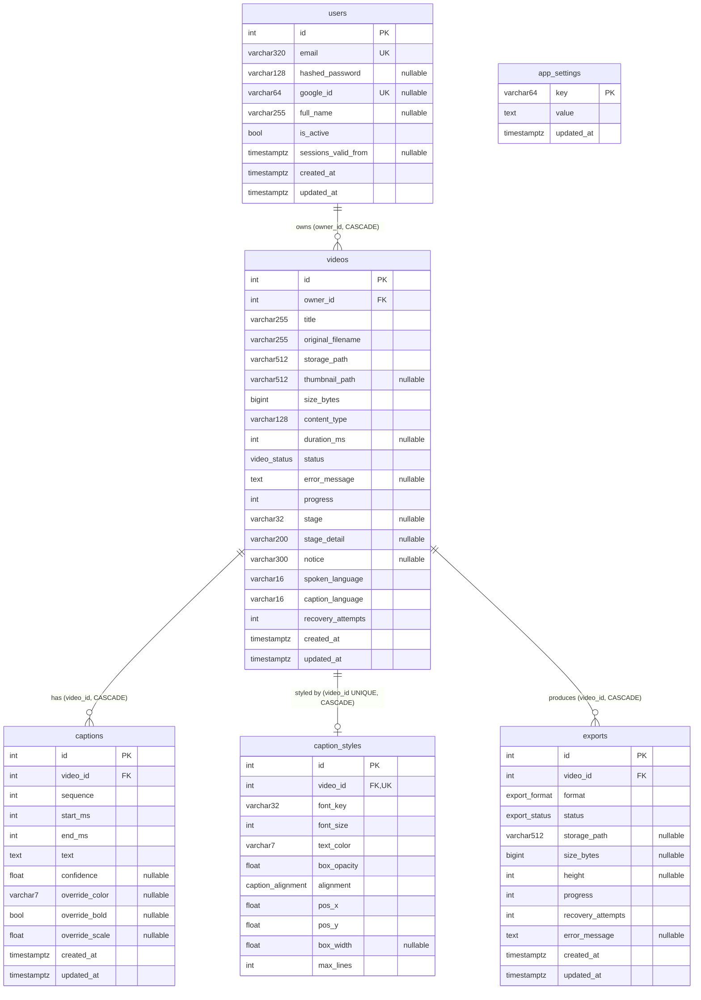

# Database

Data model as of Alembic head **`c8f2a6d41e93`** (v1.0.7). The column lists
below come from `\d` on a running v1.0.4 install's Postgres, cross-checked
against `backend/app/models/*.py`.

## 1. Where data lives

| Store | What | Source of truth for | Lost if deleted |
|---|---|---|---|
| **Postgres** (`db` volume) | users, videos, captions, caption styles, exports, install settings | everything relational, all status and progress | everything |
| **ChromaDB** (`vectors` volume, collection `captions`) | one embedding per caption, plus metadata | nothing; it is **derived** from `captions` | search only (rebuilt by re-indexing) |
| **Media volume** (`media` → `/app/storage`) | the uploaded files, thumbnails, waveform caches, export files, `audit.log` | the bytes | the videos themselves |
| **Models volume** (`models` → `/root/.cache/huggingface`) | Whisper, M2M100 and MiniLM weights | nothing | re-downloaded on next use |
| **Fonts volume** (`fonts` → `/usr/share/fonts/truetype/vcm-cache`) | Google Fonts fetched on demand | nothing | re-downloaded on next use |
| **Redis** (no persistence in prod) | Celery queue, unacked set, results; rate-limit and denylist keys (accounts mode) | nothing durable | in-flight jobs (recovered at worker start) |

Rules:

- **Files must never be stored in Postgres.** A row holds a path **relative
  to the storage root** (`storage_path`, `thumbnail_path`); the bytes are on
  the media volume.
- **Stored filenames are generated UUIDs.** The user's filename is kept only
  in `videos.original_filename`, as a label (`services/storage.py`).
- **Paths are POSIX** (forward slashes) even on Windows hosts
  (`waveform_cache_path` uses `PurePosixPath`).
- **ChromaDB has no owners.** Every query must filter by video IDs already
  proven to belong to the caller in Postgres (`services/search.py`).
- **Postgres cascades don't reach the files.** Deleting a row does not delete
  files or vectors. The service must remove them:
  - `services/video.delete_video` removes the source, thumbnail, waveform,
    vectors **and every export file** of the video (export files since v1.0.5;
    it reads their paths before the rows cascade away);
  - `services/export.delete_export` removes one export's file;
  - `storage.delete_user_files` removes a whole user's folder.

### Media volume layout

```
/app/storage/
├── audit.log, audit.log.1          request guard (local mode), ≤ ~5 MB each
└── user_<owner_id>/
    ├── <uuid>.<ext>                 the upload, byte for byte
    ├── <uuid>.jpg                   thumbnail
    ├── <uuid>.peaks.json            waveform cache (derived, disposable)
    ├── <uuid>.transcode.wav         temporary, deleted after each job
    └── exports/<uuid>.<srt|vtt|json|mp4>
```

### ChromaDB records (`services/embeddings.py`)

| Field | Value |
|---|---|
| id | `"{video_id}:{caption_id}"` (upsert, so re-runs overwrite) |
| embedding | `all-MiniLM-L6-v2` vector of the caption text |
| document | caption text |
| metadata | `video_id`, `caption_id`, `start_ms`, `end_ms` |
| collection | `captions` (`CHROMA_COLLECTION`), `hnsw:space = cosine` |

Vectors are deleted by `where={"video_id": …}` when a video is deleted or
re-indexed.

## 2. Entity-relationship diagram



`app_settings` has no relationships. `caption_styles` is abbreviated in the
diagram; its full column list is below.

## 3. Tables

Defaults in the "DB default" column exist in the database. "ORM default"
values are applied by SQLAlchemy at flush time and are **not** in the schema.

### `users` (`backend/app/models/user.py`)

| Column | Type | Null | DB default | Notes |
|---|---|---|---|---|
| `id` | integer | no | sequence | PK |
| `email` | varchar(320) | no | | unique index `ix_users_email`. Local mode creates one fixed user |
| `hashed_password` | varchar(128) | yes | | bcrypt; NULL = cannot log in with a password (Google-only) |
| `google_id` | varchar(64) | yes | | unique index `ix_users_google_id` |
| `full_name` | varchar(255) | yes | | |
| `is_active` | boolean | no | `true` | soft-disable |
| `sessions_valid_from` | timestamptz | yes | | refresh tokens issued before this are refused (accounts mode) |
| `created_at`, `updated_at` | timestamptz | no | `now()` | `updated_at` set on update by the ORM |

### `videos` (`backend/app/models/video.py`)

| Column | Type | Null | DB default | Notes |
|---|---|---|---|---|
| `id` | integer | no | sequence | PK |
| `owner_id` | integer | no | | FK → `users.id` ON DELETE CASCADE; index `ix_videos_owner_id` |
| `title` | varchar(255) | no | | upload filename stem, renamable |
| `original_filename` | varchar(255) | no | | label only, never a path |
| `storage_path` | varchar(512) | no | | relative, `user_N/<uuid>.<ext>` |
| `thumbnail_path` | varchar(512) | yes | | relative |
| `size_bytes` | bigint | no | | |
| `content_type` | varchar(128) | no | | one of the allowed video types |
| `duration_ms` | integer | yes | | NULL if probing failed |
| `status` | enum `video_status` | no | (ORM: `pending`) | `pending` `processing` `completed` `failed`; index `ix_videos_status` |
| `error_message` | text | yes | | a sentence for the user (≤ 500 chars written) |
| `progress` | integer | no | `0` | 0–100 within the current stage |
| `stage` | varchar(32) | yes | | `downloading` `extracting` `transcribing` `translating` `embedding` |
| `stage_detail` | varchar(200) | yes | | e.g. "Downloading speech model large-v3 · 1.2 of 3.1 GB" |
| `notice` | varchar(300) | yes | | non-fatal note on a finished job (fallbacks, low confidence) |
| `spoken_language` | varchar(16) | no | `'auto'` | `auto` or a language code |
| `caption_language` | varchar(16) | no | `'same'` | `same` or a caption language (`services/languages.py`: `en` `hi` `bn` `mr` `ta` `ml` `fr` `de` `nl` `es` `pt` `it` `ru`) |
| `recovery_attempts` | integer | no | `0` | automatic requeues; reset by a manual retry |
| `created_at`, `updated_at` | timestamptz | no | `now()` | |

### `captions` (`backend/app/models/caption.py`)

| Column | Type | Null | DB default | Notes |
|---|---|---|---|---|
| `id` | integer | no | sequence | PK |
| `video_id` | integer | no | | FK → `videos.id` ON DELETE CASCADE; index `ix_captions_video_id` |
| `sequence` | integer | no | | 0-based order, kept gapless on split/merge/delete |
| `start_ms`, `end_ms` | integer | no | | **integer milliseconds** (never float seconds); API enforces `start_ms < end_ms` |
| `text` | text | no | | exactly what Whisper produced, or the translation, or the user's edit |
| `confidence` | double | yes | | Whisper average log-probability; drives "Check this line" |
| `override_color` | varchar(7) | yes | | `#RRGGBB`; NULL = inherit the style |
| `override_bold` | boolean | yes | | NULL = inherit |
| `override_scale` | double | yes | | multiplier on the style's font size |
| `created_at`, `updated_at` | timestamptz | no | `now()` | |

Indexes: `ix_captions_video_sequence (video_id, sequence)` for "this video's
captions in order"; `ix_captions_video_start (video_id, start_ms)` for "which
caption covers this time".

### `caption_styles` (`backend/app/models/caption_style.py`)

One row per video, created lazily. A video without a row uses the defaults.
Sizes are in **reference pixels against a 1080-px-high canvas**
(`REFERENCE_HEIGHT`).

| Column | Type | Null | Default | Notes |
|---|---|---|---|---|
| `id` | integer | no | sequence | PK |
| `video_id` | integer | no | | FK → `videos.id` ON DELETE CASCADE; **unique** index `ix_caption_styles_video_id` |
| `font_key` | varchar(32) | no | DB `'poppins'` | a key from `FONTS` or the Google Fonts catalogue, never a free family name |
| `font_size` | integer | no | ORM 54 | |
| `bold` | boolean | no | ORM true | |
| `italic` | boolean | no | ORM false | |
| `text_color` | varchar(7) | no | ORM `#FFFFFF` | |
| `outline_color` | varchar(7) | no | ORM `#000000` | |
| `outline_width` | integer | no | ORM 3 | |
| `shadow` | integer | no | ORM 0 | offset in reference px, no blur |
| `shadow_color` | varchar(7) | no | ORM `#000000` | |
| `box_color` | varchar(7) | no | ORM `#000000` | |
| `box_opacity` | double | no | ORM 0.0 | 0 = no box (ASS BorderStyle 1); > 0 = box (BorderStyle 3) |
| `box_padding` | integer | no | ORM 8 | `BOX_PADDING_MIN` |
| `underline`, `strikeout` | boolean | no | ORM false | |
| `letter_spacing` | integer | no | ORM 0 | ASS `Spacing` |
| `uppercase` | boolean | no | ORM false | applied to the burn and the preview, **never** to stored text or SRT/VTT |
| `alignment` | enum `caption_alignment` | no | ORM `center` | `left` `center` `right`: how lines justify in the box |
| `pos_x`, `pos_y` | double | no | ORM 0.5, 0.88 | the caption box's centre, 0..1 of the frame; each caption is slid inside the 3% safe area at layout (`services/caption_layout.py`) |
| `box_width` | double | yes | | the box's width, 0..1 of the frame's width; NULL = 0.80 (landscape, square) or 0.85 (portrait) |
| `max_lines` | integer | no | `2` | 1-3; past it the font shrinks to 70%, then one more line |
| `created_at`, `updated_at` | timestamptz | no | `now()` | |

Presets (`youtube`, `tiktok`, `minimal`) and the defaults live in
`backend/app/services/caption_style.py` (`PRESETS`, `default_style_fields()`),
not in the database.

### `exports` (`backend/app/models/export.py`)

| Column | Type | Null | DB default | Notes |
|---|---|---|---|---|
| `id` | integer | no | sequence | PK |
| `video_id` | integer | no | | FK → `videos.id` ON DELETE CASCADE; index `ix_exports_video_id` |
| `format` | enum `export_format` | no | | `srt` `vtt` `json` `mp4` |
| `status` | enum `export_status` | no | (ORM `pending`) | `pending` `processing` `completed` `failed` |
| `storage_path` | varchar(512) | yes | | relative, `user_N/exports/<uuid>.<fmt>`; NULL until written |
| `size_bytes` | bigint | yes | | |
| `height` | integer | yes | | output height of a burn; NULL = source size |
| `progress` | integer | no | `0` | |
| `recovery_attempts` | integer | no | `0` | |
| `error_message` | text | yes | | |
| `created_at`, `updated_at` | timestamptz | no | `now()` | |

Index `ix_exports_video_created (video_id, created_at)`: "this video's
exports, newest first".

### `app_settings` (`backend/app/models/app_setting.py`)

Install-wide key/value settings changed at runtime: written by the API, read
by the worker at the start of each job.

| Column | Type | Null | DB default |
|---|---|---|---|
| `key` | varchar(64) | no | PK |
| `value` | text | no | |
| `updated_at` | timestamptz | no | `now()` |

Keys in use (`backend/app/services/app_settings.py`):

| Key | Written by | Value |
|---|---|---|
| `gemini_api_key` | `PATCH /api/system/settings` | the key, **plain text** (acceptable: single-user, and Postgres is reachable only on the compose network); never returned by any response; never logged (both engines use `hide_parameters=True`); blank clears it (row deleted) |
| `whisper_model` | `PATCH /api/system/settings` | `small`/`medium`/`large-v3-turbo`/`large-v3`; absent = automatic |
| `worker_hardware` | worker at `worker_ready` | JSON: `cuda`, `gpu_name`, `vram_gb`, `ram_gb`, `cpu_count`, `whisper_default`, `translator` |

### Enum types

| Postgres type | Values |
|---|---|
| `video_status` | `pending`, `processing`, `completed`, `failed` |
| `export_status` | `pending`, `processing`, `completed`, `failed` |
| `export_format` | `srt`, `vtt`, `json`, `mp4` |
| `caption_alignment` | `left`, `center`, `right` |

## 4. Naming conventions

Followed by every table and migration:

- **Tables** are plural `snake_case` (`videos`, `caption_styles`,
  `app_settings`). **Columns** are `snake_case`.
- **Foreign keys** are `<singular>_id`, and always `ON DELETE CASCADE` toward
  the owner (`owner_id`, `video_id`).
- **Indexes** are `ix_<table>_<column>` (Alembic's `op.f`) or
  `ix_<table>_<purpose>` for composites (`ix_captions_video_sequence`).
- **Enums** are Python `str` enums stored by **value** (`values_callable`),
  and the Postgres type is named `<thing>_<kind>` (`video_status`,
  `export_format`).
- **Times:** media positions are integer `_ms`; wall-clock times are
  `timestamptz` named `created_at`/`updated_at` with `server_default now()`.
- **Colours** are `varchar(7)` `#RRGGBB`. **Geometry** is in reference pixels
  (1080 p) or 0..1 fractions (`pos_x`, `pos_y`).
- **Paths** are relative to the storage root.

## 5. Migration history

Revision IDs are linear, and `down_revision` chains them in order. The "Added"
date is the commit that introduced the file.

| # | Revision | Added | What it does |
|---|---|---|---|
| 1 | `527ac85c21a5` | 2026-08-05 | create `users` |
| 2 | `26f3e4735baf` | 2026-08-06 | create `videos` + enum `video_status` (downgrade drops the enum type too) |
| 3 | `bca4d22a7575` | 2026-08-06 | create `captions` + composite indexes; add `videos.progress`, `videos.stage` |
| 4 | `4ad6619406ad` | 2026-08-07 | create `caption_styles` (+ position/alignment enums); add `captions.override_*` |
| 5 | `77c7d397c3d0` | 2026-08-07 | create `exports` (+ format/status enums), index `ix_exports_video_created` |
| 6 | `0bddc3271cec` | 2026-08-08 | add `users.sessions_valid_from` |
| 7 | `b1e7c4d92a30` | 2026-08-12 | add shadow, shadow_color, underline, strikeout, letter_spacing, uppercase, box_padding; **backfills** `box_padding = GREATEST(outline_width, 8)` so no existing box moves |
| 8 | `c3f81a5d67e2` | 2026-10-07 | `font_key` server default `'poppins'`; moves styles on `sans` to `poppins` (downgrade reverses) |
| 9 | `d7a4e91b6c05` | 2026-10-07 | add `caption_styles.pos_x`, `pos_y` (free placement) |
| 10 | `e5b2c8a41f37` | 2026-10-07 | add `exports.height` |
| 11 | `f1c93d05a827` | 2026-10-07 | add `videos.spoken_language` (`auto`), `videos.caption_language` (`same`) |
| 12 | `a9d3e6f20b14` | 2026-10-07 | create `app_settings`; add `videos.stage_detail`, `videos.notice` |
| 13 | `b4e7c2d91a36` | 2026-10-11 | add `recovery_attempts` to `videos` and `exports` (shipped in v1.0.2) |
| 14 | `c8f2a6d41e93` | 2026-10-17 | caption box (v1.0.7, head): add `box_width`, `max_lines`; `pos_x`/`pos_y` become the box centre, NOT NULL; drop `position`, `margin_v`, `margin_h` and enum `caption_vertical_position`. **Converts** every row: an anchored caption gets the centre a one-line caption had (margin + padding or outline + half the font size in from its edge, or the middle); a left/right-aligned one is half the default width (0.40) further in, the side margin read against 1920 px; a centred hand placement keeps its centre. Downgrade restores the columns at their defaults, keeping the centre as a hand placement |

## 6. Migration rules

1. **Migrations run on API start** in production (`alembic upgrade head` in
   `docker-entrypoint.sh`). The worker waits for the API to be healthy, so it
   never writes to an old schema (`depends_on: backend: service_healthy`).
   - In dev, run `docker compose exec backend alembic upgrade head` yourself.
2. **`vcm update` only ever upgrades.** A downgrade drops data. Rolling back
   `a9d3e6f20b14` drops `app_settings` and `videos.stage_detail`/`notice`
   (PROGRESS.md, R5/R9). **Never** downgrade a user's database without a
   backup.
3. **Every model must be imported in `app/models/__init__.py`.** `alembic/env.py`
   imports `app.models` so autogenerate sees every table.
4. **A new NOT NULL column on an existing table must have a `server_default`**
   (or a backfill), so existing rows and any non-ORM insert stay valid. See
   migrations 7, 8, 11 and 13.
5. **A behaviour change must backfill existing rows to their old meaning**
   (migration 7's `box_padding`, migration 8's font move).
6. **A downgrade that drops a table must also drop its enum types.**
   Otherwise the next upgrade fails with "type … already exists" (migration 2).
7. **Never edit a migration that has shipped** in a release (v1.0.0 and
   later). Add a new revision instead. This follows from rule 2: installs
   identify their state by revision ID.
8. **Test the update path.** Roll the dev or test install back one revision,
   run the upgrade, then compare row counts and a checksum of caption text
   (the R5 procedure in [TESTING.md](TESTING.md)).
9. **Every test run builds the schema from empty.** `backend/tests/conftest.py`
   drops and recreates `<db>_test`, then runs `alembic upgrade head`, so a
   migration that can't build a fresh database fails the suite (locally and
   in CI). `tests/test_isolation.py` checks it reached the head revision.

## 7. Backup and restore

**`vcm` has no backup command yet** (`vcm backup`/`vcm restore` are on the
[ROADMAP](ROADMAP.md)). Nothing in the product backs up data automatically.
The procedure below uses the real container and volume names of an install
(compose project `vcm`).

**Tested on 2026-10-14**, exactly as written:
- backed up the Windows install (31 videos, 505 captions, 93 exports,
  114 MB of media); downtime 15 s;
- restored into a throwaway install (compose project `vcmbk`, fresh secrets,
  the same images);
- result: identical row counts, an identical md5 of all caption text, the
  same Alembic head, and an identical checksum over all 179 media files;
- the restored app served the UI and streamed a video, and was then removed
  with `docker compose -p vcmbk down -v`.

For another project name, replace the `vcm` prefix in the container and volume
names.

What has to be saved together:
- the Postgres database;
- the `vcm_media` volume (the videos and exports);
- the install's `.env`, which holds `POSTGRES_PASSWORD` for the `vcm_db`
  volume and `JWT_SECRET_KEY`.

ChromaDB, models and fonts can be rebuilt or re-downloaded.

```bash
# 1. Quiesce: stop everything that writes, keep Postgres up
docker stop vcm-frontend-1 vcm-worker-1 vcm-backend-1

# 2. Database (custom format)
docker exec vcm-postgres-1 pg_dump -U vcm -d vcm -Fc > vcm.dump

# 3. Media volume
docker run --rm -v vcm_media:/data -v "$PWD":/backup busybox \
  tar czf /backup/vcm-media.tgz -C /data .

# 4. Start again
docker start vcm-backend-1 vcm-worker-1 vcm-frontend-1
```

Restore into an install (same or newer version):

```bash
docker stop vcm-frontend-1 vcm-worker-1 vcm-backend-1
docker exec -i vcm-postgres-1 pg_restore -U vcm -d vcm --clean --if-exists < vcm.dump
docker run --rm -v vcm_media:/data -v "$PWD":/backup busybox \
  sh -c "rm -rf /data/* && tar xzf /backup/vcm-media.tgz -C /data"
docker start vcm-backend-1 vcm-worker-1 vcm-frontend-1   # the API runs newer migrations on start
```

After a restore into a fresh install the search index is empty. Use **Redo**
on a video, or edit a caption, to queue its re-index (a library-wide re-index
command is on the [ROADMAP](ROADMAP.md)).

**Never** restore a dump from a *newer* schema into an older install.

**Never** copy `vcm-*.dump` files into the repository: `*.dump` is gitignored
because it holds user data.

## Decisions recorded

Answers from the maintainer (2026-10-14) to this document's former open
questions:

| Question | Answer |
|---|---|
| Backup/restore untested | Tested once and marked tested (§7). `vcm backup`/`vcm restore` → [ROADMAP](ROADMAP.md). |
| Library-wide re-index command | → [ROADMAP](ROADMAP.md). |
| Gemini key in plain text | Acceptable for a local single-user app; Postgres is not exposed outside Docker. Confirmed never returned and never logged (fixed in v1.0.5: SQL echo used to print bound values in dev). |
| Export files orphaned on video delete | Fixed in v1.0.5. |
| Style defaults in the ORM vs the DB | Noted, minor: only `font_key` has a DB default, the rest are ORM defaults. No change now. |
